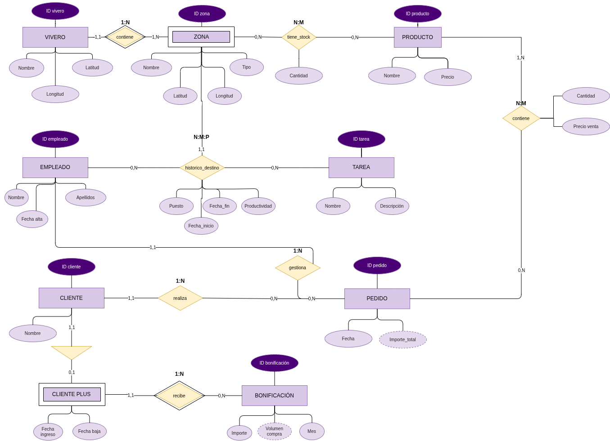
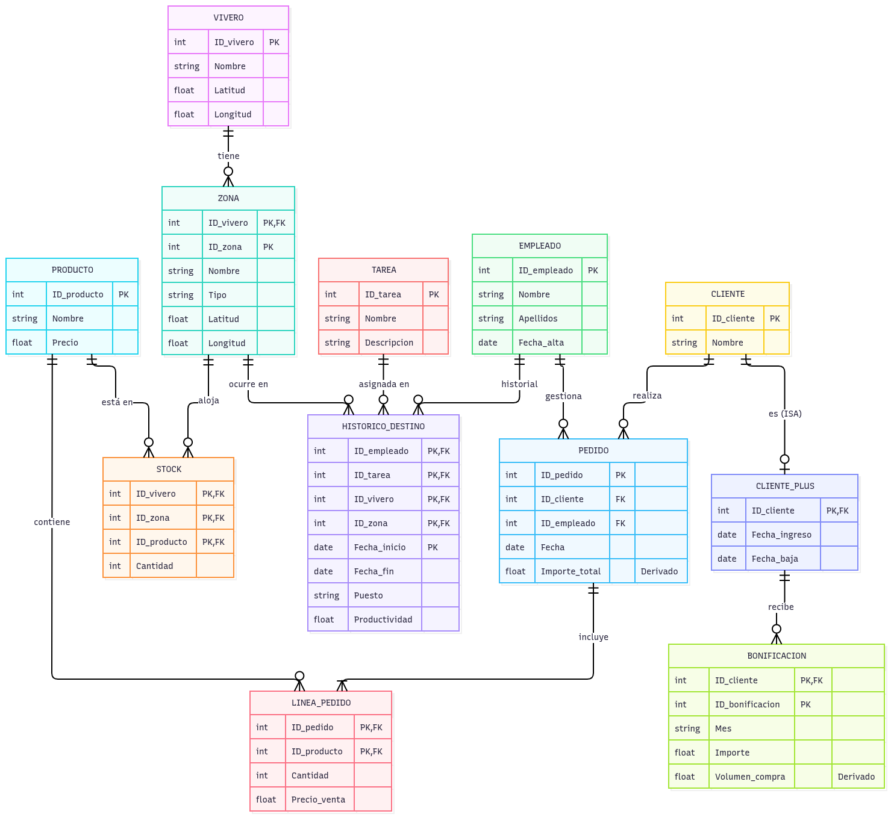

# P3_ADBD
## Imagen del modelo entidad/relación del escenario de viveros empleados en (i) formato .drawio y (ii) formato .png.

## Imagen del diseño relacional realizado.

## Script SQL generado para construir la base de datos (fichero con extensión .sql) PUEDE SER CON DBEAVER, CREAR UN ADMIN DE LA BASE DE DATOS
Se encuentra en el fichero **script.sql** del repositorio.

## Imagen con la salida de un SELECT de cada tabla de la base de datos.
Estan incluidas en el repositorio 4 imagenes de distintos select que muestran:
1. El inventario de productos en cada zona
2. Muestra qué empleado hace qué tarea y su puesto.
3. Muestra qué cliente hizo el pedido, la fecha, y la cantidad y precio de los productos que contiene.
4. Muestra la fecha de alta de los clientes suscritos y el dinero de bonificación que han recibido cada mes.